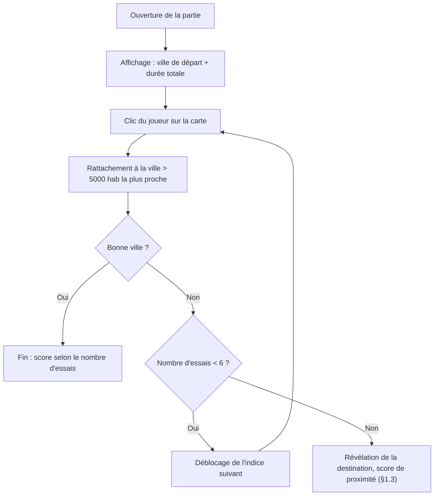
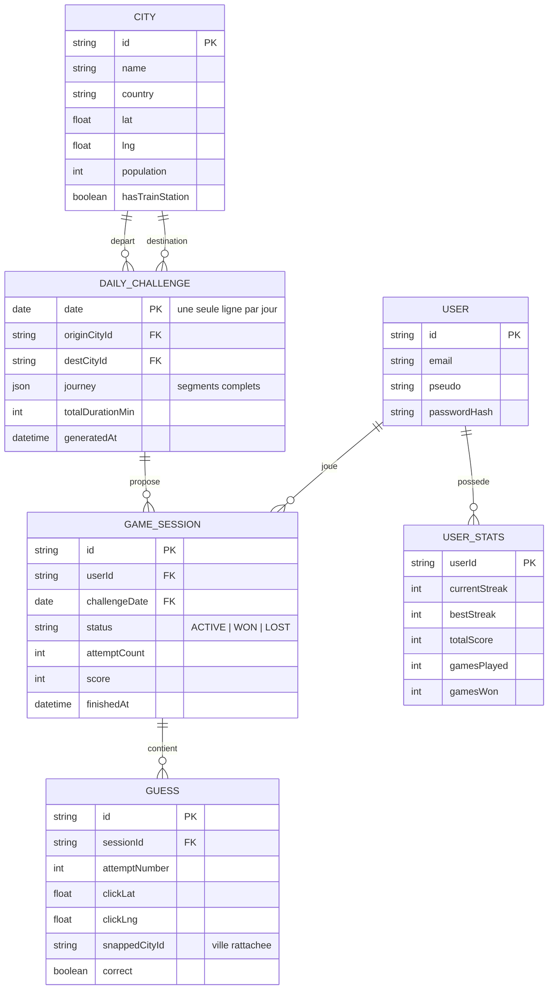

# 🚆 Destination Mystère — Spécifications & document d'instructions

> **Jeu quotidien de devinette d'itinéraire.** Chaque jour, le système génère un trajet entre une ville française (avec gare) et une ville européenne, calculé en transports en commun uniquement. Le joueur ne voit que la ville de départ et la durée totale ; il doit localiser la destination sur une carte. Les indices se débloquent essai après essai.

**Noms de code possibles :** *Destination Mystère*, *Terminus*, *Dernier Arrêt*, *Cap Final*.

---

## 1. Règles du jeu

### 1.1 Le défi quotidien

- **Départ** : une ville de France possédant **au minimum une gare de train**.
- **Destination** : une ville d'Europe (hors France), joignable en transports en commun.
- **Itinéraire** : le **plus rapide** combinant uniquement **train, avion et transports publics urbains/interurbains** (métro, tram, bus, RER, TER, TGV, etc.). Aucun trajet en voiture ni à pied de bout en bout (les correspondances à pied courtes sont tolérées).
- Le défi est **identique pour tous les joueurs** le même jour (comme Wordle).

### 1.2 Déroulement d'une partie

| Étape | Ce que le joueur voit |
|---|---|
| **Ouverture** | Ville de départ + **durée totale du trajet** (portes-à-portes) |
| **Essai 1** | Clic sur la carte → rattaché à la **ville > 5 000 habitants la plus proche** |
| **Après chaque clic** | La ville devinée est épinglée sur la carte avec sa **distance à la destination secrète** (« à X km du but ») |
| **Après l'échec 1** | **Indice A** : la liste ordonnée des **modes de transport**, ramenés aux seules catégories **transports urbains / avion / train** (ex. « Transports urbains → Avion → Transports urbains »), **sans les durées** |
| **Après l'échec 2** | **Indice B** : les **modes de l'indice A et les durées des segments ensemble** (ex. « Transports urbains — 36 min → Avion — 107 min → Transports urbains — 31 min ») |
| **Après l'échec 3** | **Indice C** : le **nom des lignes / compagnies** (ex. « TER Grand Est, TGV inOui, Air France, Métro ligne 14 ») |
| **Après l'échec 4** | **Indice D** : le **nom des compagnies empruntées** (ex. « Métro ligne 12, Air France, TGV InOui ») |
| **Après l'échec 5** | **Indice E** : une **destination intermédiaire** du trajet — jamais la destination, ni l'avant-dernier arrêt |
| **Essai 6** | Dernier essai : victoire à 250 pts, sinon **score de proximité** (§1.3) |
| **Après l'échec 6** | Révélation de la destination + score de proximité selon la distance du dernier clic |

- **Maximum : 6 essais.** Une proposition est juste si la ville rattachée au clic est la ville de destination.
- Après chaque clic, afficher la ville devinée sur la carte (épingle) **et la distance à vol d'oiseau entre la ville devinée et la destination secrète** (« à X km du but »), pour que le joueur puisse s'orienter.

### 1.3 Score

| Essai où la destination est trouvée | Score |
|---|---|
| 1ᵉʳ | 1000 |
| 2ᵉ | 850 |
| 3ᵉ | 700 |
| 4ᵉ | 550 |
| 5ᵉ | 400 |
| 6ᵉ | 250 |
| Échec (6ᵉ clic raté) | **Score de proximité** : arrondi de 250 × (1 − d/200) où d = distance entre la ville du dernier clic et la destination ; **0 si d > 200 km** |

- Classement du jour trié par **score décroissant**, puis par **temps de résolution** (horodatage serveur) croissant pour départager les égalités.
- Statistiques joueur : série de jours consécutifs joués (*streak*), moyenne de score, taux de réussite.

### 1.4 Boucle de jeu



---

## 2. Architecture recommandée

**Stack retenue** (un seul dépôt, full-stack TypeScript) :

| Couche | Choix | Justification |
|---|---|---|
| Framework | **Next.js 14+ (App Router, TypeScript)** | Front + API dans un seul projet, SSR, déploiement simple |
| Base de données | **PostgreSQL + Prisma** | Modèle relationnel naturel (défi du jour, parties, classement) ; PostGIS utile pour le rattachement ville |
| Carte | **MapLibre GL JS + tuiles OpenFreeMap** | Gratuit, sans clé API, open source |
| Tâche quotidienne | **Cron** (Vercel Cron, GitHub Actions ou node-cron sur VPS) | Génération du défi 1×/jour |
| Auth | NextAuth (e-mail/magic link ou identifiants) | Nécessaire pour le classement multi-joueurs |
| Tests | Vitest | Logique de score, indices et rattachement testables unitairement |

**Principe directeur : le serveur fait autorité.** Le client ne reçoit **jamais** la destination ni l'itinéraire complet avant la fin de la partie. Toute la logique (rattachement du clic, déblocage des indices, score) s'exécute côté serveur.

---

## 3. Structure de dossiers

```text
destination-mystere/
├── README.md
├── package.json
├── tsconfig.json
├── next.config.mjs
├── .env.example              # DATABASE_URL, SNCF_API_TOKEN, CRON_SECRET, AUTH_SECRET
├── .gitignore
│
├── prisma/
│   ├── schema.prisma          # Modèle de données (§4)
│   └── seed.ts                # Import des villes et aéroports
│
├── data/                      # Données statiques versionnées
│   ├── cities/
│   │   ├── cities.france.json # Villes françaises > 5000 hab, avec flag hasTrainStation
│   │   └── cities.europe.json  # Villes européennes > 5000 hab (destinations possibles)
│   └── airports/
│       └── airports.europe.json  # Aéroports (OpenFlights filtrés)
│
├── scripts/
│   ├── prepare-cities.ts      # Télécharge/filtre GeoNames → data/cities/*.json
│   ├── prepare-airports.ts    # Filtre OpenFlights → data/airports/
│   └── import-db.ts           # Importe les JSON en base
│
├── src/
│   ├── app/
│   │   ├── layout.tsx
│   │   ├── page.tsx                        # Accueil : défi du jour, streak
│   │   ├── jouer/
│   │   │   └── page.tsx                    # Écran de jeu (carte + indices)
│   │   ├── classement/
│   │   │   ├── page.tsx                    # Classement du jour
│   │   │   └── archives/page.tsx           # Défis passés + stats globales
│   │   ├── connexion/page.tsx
│   │   ├── inscription/page.tsx
│   │   └── api/
│   │       ├── challenge/route.ts          # GET  : défi du jour (payload masqué)
│   │       ├── guess/route.ts              # POST : proposer un point (lat/lng du clic)
│   │       ├── hint/route.ts               # GET  : indices déjà débloqués (jamais +)
│   │       ├── leaderboard/route.ts
│   │       ├── auth/[...nextauth]/route.ts
│   │       └── cron/generate-daily/route.ts  # POST protégé par CRON_SECRET
│   │
│   ├── components/
│   │   ├── map/
│   │   │   ├── GameMap.tsx                 # Carte MapLibre, gestion du clic
│   │   │   ├── GuessPin.tsx                # Épingles des propositions
│   │   │   └── RouteOverlay.tsx            # Tracé de l'itinéraire (fin de partie)
│   │   ├── game/
│   │   │   ├── ClueBoard.tsx               # Panneau des indices révélés
│   │   │   ├── AttemptHistory.tsx
│   │   │   ├── EndScreen.tsx               # Score + révélation + itinéraire complet
│   │   │   └── StreakBadge.tsx
│   │   ├── leaderboard/
│   │   │   └── LeaderboardTable.tsx
│   │   └── ui/                             # Boutons, modales, toasts
│   │
│   ├── lib/
│   │   ├── db.ts               # Client Prisma singleton
│   │   ├── auth.ts
│   │   ├── geo/
│   │   │   ├── snap.ts         # Clic (lat/lng) → ville > 5000 hab la plus proche
│   │   │   ├── grid-index.ts   # Index geohash pour un snap rapide
│   │   │   └── haversine.ts
│   │   └── format/
│   │       └── duration.ts     # Formatage des durées (7 h 42)
│   │
│   └── server/                 # Logique métier — uniquement côté serveur
│       ├── game-service.ts     # État de partie, essais, déblocage d'indices, score
│       ├── daily-challenge.ts   # Sélection déterministe du duo de villes (seed = date)
│       ├── scoring.ts
│       ├── hints.ts            # Projette un itinéraire en indices A/B/C/D
│       └── routing/
│           ├── planner.ts      # Compare rail seul vs rail+avion → itinéraire le plus rapide
│           ├── sncf.ts         # Client API SNCF/Navitia (rail)
│           ├── flights.ts      # Estimation des vols (distance orthodromique)
│           └── types.ts        # Segment, Journey, JourneyLeg...
│
└── tests/
    ├── scoring.test.ts
    ├── hints.test.ts
    ├── snap.test.ts
    └── daily-challenge.test.ts
```

**Convention importante :** tout ce qui touche à la vérité du jeu (itinéraire, indices, score) vit dans `src/server/` et n'est **jamais importé par du code client**. Le dossier `components/` n'accède aux données que via les routes API.

---

## 4. Modèle de données



**Contenu de `journey` (JSON)** — c'est la structure pivot du jeu :

```jsonc
{
  "totalDurationMin": 412,
  "segments": [
    {
      "mode": "rail",                    // rail | air | urban | intercity_bus
      "modeDetail": "TER",               // TER, TGV, Métro, Tram, Bus, Avion...
      "lineOrCarrier": "TER Grand Est",  // indice C
      "durationMin": 38,                 // indice B
      "from": "Reims",
      "to": "Paris-Est",
      "intermediateStops": ["Château-Thierry"] // pour l'indice E
    }
    // ...
  ]
}
```

Chaque indice est une **projection** de cette structure : A = `modeDetail` de chaque segment, ramené aux catégories **transports urbains / avion / train** ; B = modes de A + `durationMin` ; C = + `lineOrCarrier` ; D = **nom des compagnies empruntées** (affinement de `lineOrCarrier`) ; E = une **destination intermédiaire** du trajet, jamais la dernière ni l'avant-dernière étape. Un seul champ, `journey`, alimente toute la mécanique — simple à maintenir et à tester.

---

## 5. Sources de données externes

### 5.1 Trains et transports publics — API SNCF (Navitia)

- **Endpoint :** `https://api.sncf.com/v1/coverage/sncf/…` — l'API SNCF repose sur Navitia ; documentation sur doc.navitia.io.
- **Accès :** token gratuit, authentification HTTP Basic (username = le token, mot de passe vide). Demande sur digital.sncf.com/startup/api/token.
- **Quotas :** ~150 000 requêtes/mois, ~5 000/jour — largement suffisant car **la génération ne tourne qu'une fois par jour** (et non par joueur).
- **Couverture :** horaires théoriques TGV, TER, Transilien, Intercités, et trains internationaux vendus par la SNCF (Eurostar, TGV Lyria, ICE, etc.).
- **Endpoints utiles :** `/journeys` (itinéraires porte-à-porte avec correspondances), `/places` (autocomplétion), `/vehicle_journeys`.
- **Limite à documenter :** la couverture gratuite est centrée sur la France et les trains qu'elle vend. Pour les tronçons urbains à l'étranger (métro de Berlin, bus de Varsovie), compléter par une **estimation paramétrique** (vitesse moyenne par mode) plutôt que par une API dédiée. C'est acceptable pour un jeu : l'important est la vraisemblance et la cohérence.

### 5.2 Avions — estimation (pas d'API payante)

> ⚠️ **Amadeus Self-Service (tier gratuit) a fermé aux nouveaux comptes le 17 juillet 2026.** Ne pas bâtir le jeu dessus.

Recommandation pour la v1 : **estimer les vols sans API**.

1. Base **OpenFlights** (domaine public) : aéroports du monde avec coordonnées et codes IATA.
2. Vol = aéroport majeur le plus proche de la ville de départ → aéroport majeur le plus proche de la destination (avec liaison probable).
3. **Durée de vol estimée** = distance orthodromique ÷ 800 km/h + 35 min de marge (taxi, embarquement). Ajouter les tronçons train vers/depuis les aéroports via l'API SNCF.
4. Le planificateur (`planner.ts`) compare **rail seul vs rail + avion** et retient le plus rapide.

Piste d'évolution (optionnelle) : sandbox gratuite de **Duffel** pour des durées de vol réelles si le besoin s'en fait sentir.

### 5.3 Villes > 5 000 habitants — GeoNames

- Fichier **`cities5000.zip`** (licence CC-BY 4.0, gratuit) : toutes les villes du monde de plus de 5 000 habitants avec coordonnées et population.
- `scripts/prepare-cities.ts` filtre : bbox Europe, population > 5 000, sépare France (enrichie du flag `hasTrainStation` via la liste des gares voyageurs SNCF / l'API Navitia) et reste de l'Europe.
- Le rattachement du clic se fait **sur ce jeu de données en base** (~20–30 000 villes en Europe), avec un index spatial (geohash ou PostGIS `KNN`) pour que le snap soit en quelques millisecondes.

### 5.4 Fond de carte

- **MapLibre GL JS** + tuiles **OpenFreeMap** : gratuits, sans clé, sans limite dure. Alternative : MapTiler (tier gratuit).

### 5.5 Variables d'environnement

```text
DATABASE_URL=postgresql://...
SNCF_API_TOKEN=...        # token Navitia/SNCF
CRON_SECRET=...           # protège /api/cron/generate-daily
AUTH_SECRET=...           # NextAuth
NEXT_PUBLIC_MAP_TILES_URL=https://tiles.openfreemap.org/styles/liberty
```

---

## 6. Génération quotidienne de l'itinéraire

1. **Cron à 05:00 (Europe/Paris)** : `POST /api/cron/generate-daily` (protégé par `CRON_SECRET`).
2. **Sélection déterministe** : PRNG avec **la date comme graine** → le même duo de villes pour tous, reproductible en cas de régénération. Contraintes de sélection : distance min/max, ville de départ avec `hasTrainStation = true`, destination dans un pays desservi.
3. **Calcul** : `planner.ts` interroge l'API SNCF (rail) + le module vols (estimation), assemble 2 à 3 itinéraires candidats, retient le plus rapide, le normalise en `journey` (§4).
4. **Stockage** dans `DailyChallenge` (une ligne par date, upsert).
5. **Repli (fallback)** : si les APIs échouent, réutiliser un itinéraire de la réserve (`data/` ou table `FallbackRoute`) plutôt que de laisser le jour sans défi. Générer systématiquement le défi de **J+1** en avance.
6. **Budget API** : quelques requêtes par jour maximum, très en dessous du quota SNCF.

---

## 7. Sécurité et anti-triche (multi-joueurs)

Le client ne doit **jamais** pouvoir deviner la destination par inspection du code ou du réseau.

- **Payload du défi** (`GET /api/challenge`) : ville de départ (nom, coordonnées), durée totale, indices déjà débloqués. **Jamais** `journey`, **jamais** les coordonnées de la destination.
- **Proposition** (`POST /api/guess`) : le client n'envoie que `lat`/`lng` du clic. C'est le **serveur** qui rattache à la ville la plus proche, vérifie, incrémente les essais, débloque l'indice suivant et renvoie le nouvel état.
- Les indices sont servis **par le serveur uniquement selon le nombre d'essais enregistré** — pas de déblocage côté client.
- Une seule `GameSession` par joueur et par jour (contrainte d'unicité).
- **Limitation de débit** sur `/api/guess` (ex. 1 req/s) et vérification d'authentification.
- La révélation complète (`journey`) n'est renvoyée qu'à la fin de partie (victoire ou 6 échecs), ou après la fin de la journée pour les curieux qui n'ont pas joué (page archives).
- Le tracé de l'itinéraire sur la carte n'apparaît qu'à l'écran de fin.

---

## 8. Jalons de développement (à passer au modèle, jalon par jalon)

> Donner **un jalon à la fois** au modèle, avec les critères d'acceptation. Ne pas demander tout le projet d'un bloc : chaque jalon reste vérifiable, et le contexte reste dans la fenêtre du modèle.

**M0 — Socle.** ✅ Réalisé. Projet Next.js + Prisma + Postgres créé, `.env.example`, lint et tests configurés.
✔ Critères : `npm run dev` démarre une page blanche ; `npm test` passe.

**M1 — Données.** ✅ Réalisé. Scripts `prepare-cities` / `prepare-airports` + import en base ; index spatial ; `snap.ts` renvoie la ville la plus proche. Jeux de données générés : 2 076 villes françaises (1 450 avec gare à moins de 3 km), 17 572 destinations européennes, 1 031 aéroports.
✔ Critères (validés sur données réelles) : le snap est **exact** — identique à la force brute sur 300 clics aléatoires ; médiane ≈ 0,03 ms, p95 ≈ 0,4 ms ; tests unitaires du snap, du geohash (ancres Wikipédia) et du haversine. *Ajustement* : « un clic à 20 km de Reims renvoie Reims » n'est pas réaliste — les communes de 5 000–10 000 habitants (Bétheny, Tinqueux, Cormontreuil, Épernay) entourent les grandes villes ; le test retenu vérifie Reims sur la ville même et à 2 km dans les azimuts dégagés, cf. §11.5.

**M2 — Génération du défi.** `daily-challenge.ts` (PRNG seedé), clients `sncf.ts` / `flights.ts`, `planner.ts`, route cron, fallback, modèle `DailyChallenge`.
✔ Critères : le cron crée un défi pour la date du jour avec `journey` complet et durée totale cohérente ; relancer deux fois donne le même duo de villes ; un échec API bascule sur le fallback.

**M3 — Jeu solo.** Écran de jeu avec carte MapLibre, clic → snap → vérification serveur, déblocage des indices A→E, distance au but après chaque clic, score et score de proximité, écran de fin avec tracé de l'itinéraire.
✔ Critères : impossible de trouver la destination dans la réponse réseau avant la fin ; la séquence d'indices respecte §1.2 ; tests de `hints.ts` et `scoring.ts`.

**M4 — Multi-joueurs.** Auth, `GameSession` unique/joueur/jour, classement du jour, archives, streaks.
✔ Critères : deux comptes sur le même défi obtiennent le même itinéraire ; le classement trie par score puis temps de résolution.

**M5 — Finition.** Partage du résultat (texte type « 🟩⬜ Trouvé en 3 essais ! » sans révéler la destination), archives publiques des anciens défis, statistiques joueur, page « Comment jouer ».
✔ Critères : le partage ne fuite aucune information sur les défis non joués.

---

## 9. Prompt maître à passer au modèle

> À copier-coller en début de conversation avec le modèle de code, en joignant le présent document.

```text
Tu es un développeur full-stack senior. Tu construis « Destination Mystère », un jeu web
quotidien multi-joueurs. Je te fournis un document de spécification complet : lis-le
intégralement avant d'écrire la moindre ligne de code, et respecte-le à la lettre.

CONTEXTE DU JEU
Chaque jour, le système génère l'itinéraire le plus rapide (transports en commun, train,
avion uniquement) entre une ville française possédant une gare et une ville européenne.
Le joueur voit la ville de départ et la durée totale, puis clique sur une carte pour
devine la destination ; son clic est rattaché à la ville de plus de 5 000 habitants la
plus proche. La distance à la destination s'affiche après chaque clic. Après chaque
erreur, un indice se débloque : (A) modes de transport (transports urbains / avion /
train), (B) modes et durées des segments ensemble, (C) lignes/compagnies, (D) compagnies
empruntées, (E) une destination intermédiaire (jamais la dernière ni l'avant-dernière
étape). 6 essais maximum ; score de 1000 (1er essai) à 250 (6e) ; en cas d'échec au 6e,
score de proximité selon la distance du dernier clic (0 au-delà de 200 km).

RÈGLES NON NÉGOCIABLES
1. Logique 100 % côté serveur : la destination et l'itinéraire complet ne sont JAMAIS
   envoyés au client avant la fin de la partie.
2. Le rattachement du clic (lat/lng → ville > 5000 hab la plus proche) se fait côté
   serveur, sur la base GeoNames importée, avec un index spatial.
3. Les indices sont servis par le serveur selon le nombre d'essais enregistré en base.
4. Le défi du jour est identique pour tous les joueurs : sélection déterministe par
   PRNG avec la date comme graine.
5. Génération de l'itinéraire UNE FOIS par jour via cron (API SNCF/Navitia pour le
   rail, estimation orthodromique pour les vols), avec itinéraire de repli si les
   APIs échouent. Aucune génération à la volée par joueur.

STACK ET STRUCTURE
Next.js 14+ (App Router, TypeScript strict), PostgreSQL + Prisma, MapLibre GL JS +
tuiles OpenFreeMap, NextAuth, Vitest. Suis exactement la structure de dossiers du
document de spécification. Le dossier src/server/ ne doit jamais être importé par
du code client.

MODALITÉS DE TRAVAIL
Nous avançons jalon par jalon (M0 à M5, cf. §8 du document). À chaque jalon :
- écris le code complet, sans fonctions vides ni TODO ;
- ajoute les tests unitaires du jalon et fais-les passer ;
- liste à la fin ce qui est fait, ce qui reste, et les variables d'environnement
  à définir.
Attends ma validation d'un jalon avant de passer au suivant. Si une information
te manque, choisis l'option la plus simple et signale-la explicitement plutôt que
de demander et d'attendre.

QUALITÉ ATTENDUE
TypeScript strict sans any non justifié ; gestion d'erreur explicite sur tous les
appels d'API externes (timeout + fallback) ; durées en minutes entières côté métier,
formatées à l'affichage ; commits/étapes courts et lisibles.
```

---

## 10. Pièges à éviter (rétro-planning des erreurs classiques)

- **Ne pas calculer l'itinéraire à chaque joueur** : un défi par jour, stocké, servi depuis la base.
- **Ne pas envoyer le `journey` au client** même « masqué » : filtrer côté serveur, toujours.
- **Ne pas payer pour les vols** : l'Amadeus gratuit est fermé aux nouveaux comptes ; l'estimation orthodromique suffit à un jeu.
- **Ne pas faire le snap en parcourant 30 000 villes** : index geohash ou PostGIS.
- **Ne pas laisser la date du client piloter quoi que ce soit** : fuseau Europe/Paris, graine = date serveur, sinon un joueur peut rejouer ou deviner le lendemain.
- **Ne pas générer des indices à la main** : tout découle de la projection du champ `journey` (§4) ; un seul endroit à maintenir.
- **Ne pas bâtir sur l'API temps réel** : les horaires théoriques suffisent ; le temps réel n'apporte rien à un puzzle et double les points de panne.

---

## 11. Prochaines décisions à prendre (hors périmètre du modèle)

1. **Nom définitif + domaine.** À trancher avant le M5 (partage, page d'accueil).
2. **Déploiement.** Vercel + Postgres managé (Neon, Supabase) est le chemin le plus court ; un VPS suffit aussi (node-cron + Docker).
3. **Curseur de difficulté.** Ajouter plus tard un filtrage des destinations par distance (ex. défis « courts » en début de semaine, longs le week-end) — le champ `journey` et la graine datée le permettent sans migration.
4. **Villes ambiguës.** Décider de la politique pour les homonymes (ex. Saint-Étienne) : identification par `id` GeoNames, jamais par nom.
5. **Seuil de population des villes « devinables ».** Constat M1 : autour des grandes villes, des communes de 5 000–10 000 habitants captent les clics approchants (à 20 km de Reims, le clic rattache à Bétheny, Épernay ou Fismes). Options : (a) garder la règle stricte > 5 000 hab. (comportement actuel, fidèle à la demande initiale) ; (b) réserver les villes devinables à un seuil supérieur (ex. > 15 000 hab.) tout en rattachant le clic sur le jeu complet — le joueur verrait « proche de X » quand il vise une banlieue. Décision attendue avant le jalon M3 (elle change le référentiel de comparaison, pas l'algorithme).
